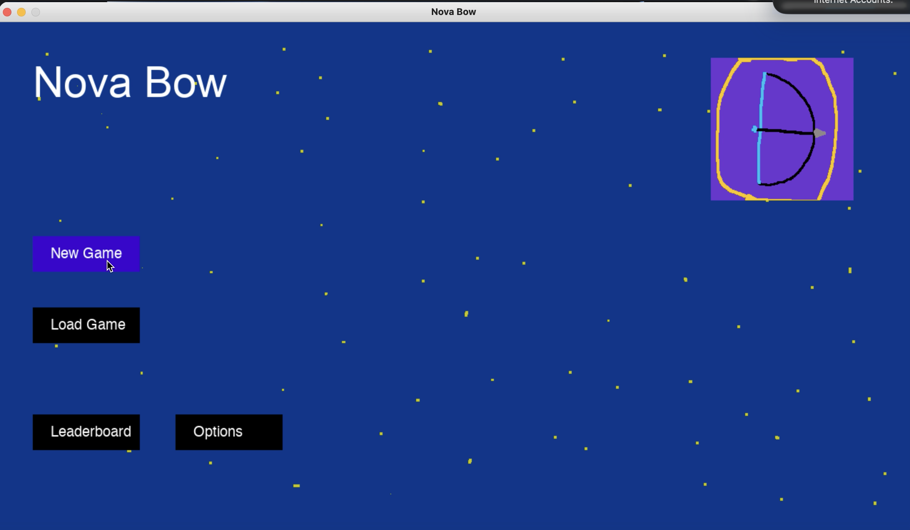
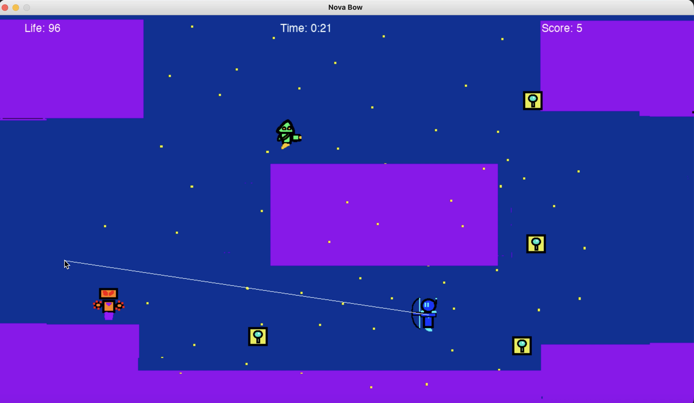
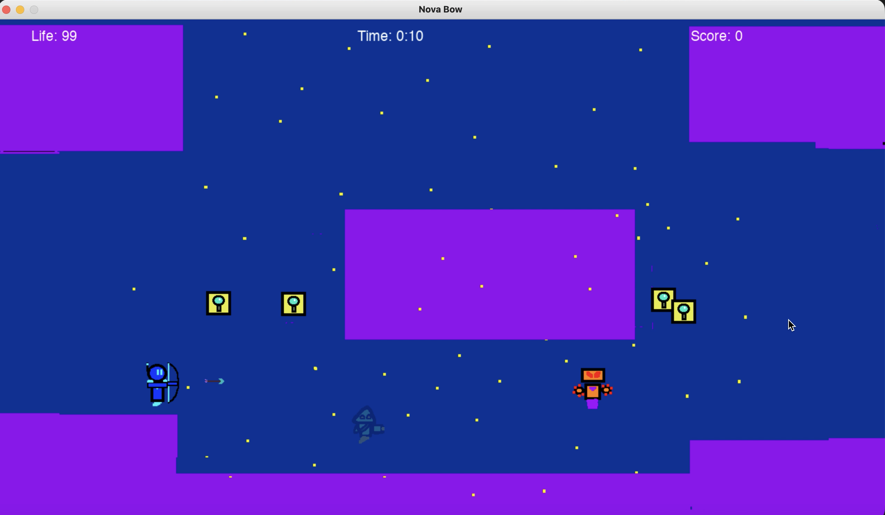
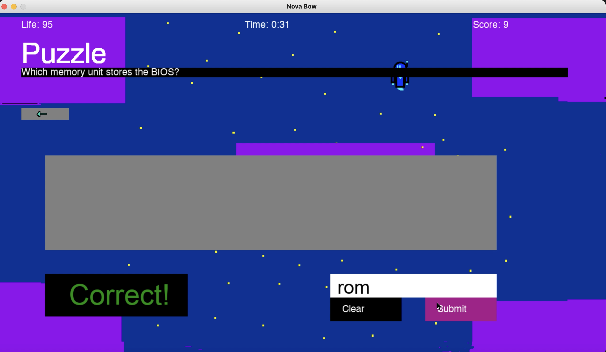
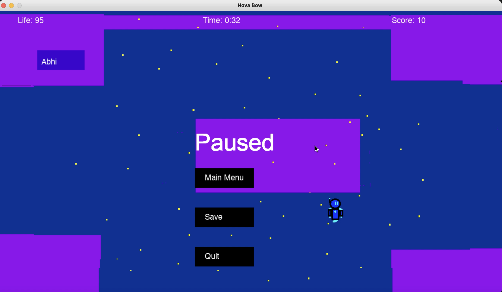
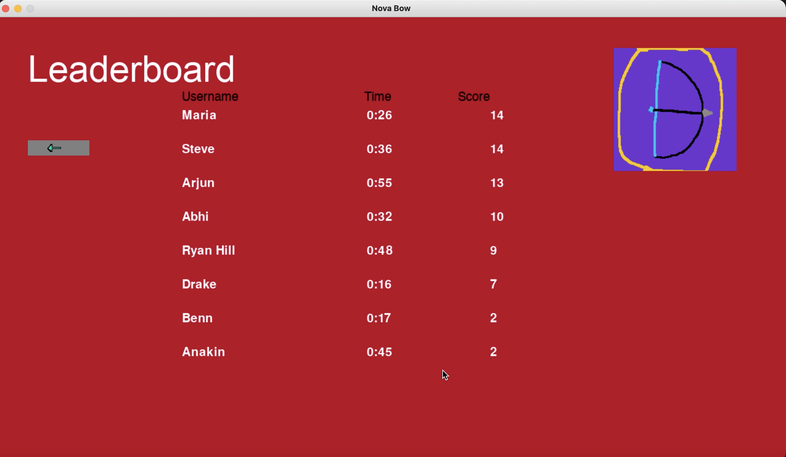

# Nova Bow 🏹🌌

A 2D top-down exploration, archery, and puzzle game built in Python (`Pygame`) for my A-Level Computer Science project. Designed to pair accessible archery physics with A-Level revision, updatable player profiles, and a competitive leaderboard.

## Core Gameplay & Features
* **2D Exploration World:** Navigate across a 9-screen interconnected space environment (`1280x720` resolution) featuring boundary detection, room transitions, and patrolling enemy classes (`EnemyH`, `EnemyV`).
* **Trigonometric & Kinematic Archery Mechanics:** Toggle into archery mode (`E`) to aim a 360° dynamic target line with the mouse. Arrow launch angles are calculated using quadrant-aware `arctan` trigonometry, while flight trajectories simulate initial draw velocity and gravitational acceleration.
* **Interactive Puzzle System:** Touching randomly spawned puzzle boxes pauses combat and opens a dedicated problem-solving interface—complete with a rough-work scratchpad (`Working Box`), answer entry, and dynamic scoring loaded from `puzzles.csv'.
* **User Accounts, Save States & Leaderboard:**
  * Full sign-up and login validation enforcing username uniqueness and NIST-inspired password rules.
  * Deterministic password hashing and persistent state storage in `players.csv` (saving current area, health, elapsed time, score, and `(x, y)` coordinates).
  * Top-10 High Score Leaderboard sorted in descending order.
* **Features original sprite and background art!

## Tech Stack & Architecture
* **Language & Libraries:** Python 3, `Pygame` (rendering, sprite groups, event loop, audio mixer), `Pandas` / `csv` (file persistence), `math`, `random`.
* **Object-Oriented Structure:** Modular classes for `Player`, `Arrow`, `Enemy` (with horizontal/vertical inheritance subclasses), `puzzleBox`, and interactive UI components (`Button`, `textBox`).

## Screenshots

